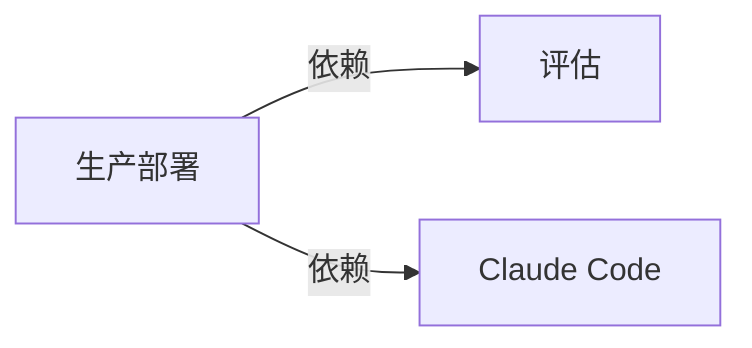

# 生产部署

> **分类**：企业落地与组织 ｜ **英文**：production deployment ｜ **出现于 2 篇文章**

## 摘要

生产部署指把智能体从试验环境推进到真实业务环境中运行的过程，是智能体项目从演示走向实际价值的最后一步。它之所以重要，是因为只有经过安全评估并在真实业务负载下运行，智能体的效果与风险才能被真实验证；资料也强调要"安全地大规模评估和部署智能体"。

## 关键做法

- 先打好智能体式 AI 的基础，理解智能体的基本构成与行为方式，再进入部署阶段。
- 以"生产就绪"为目标设计智能体，而不是把演示原型直接搬到线上。
- 部署前完成评估，把评估作为部署的前置条件，确认智能体在目标场景下的表现可接受。
- 关注安全性与规模化：在扩大使用范围的同时，持续控制智能体带来的风险。
- 参考真实部署案例，借鉴同类客户在实际业务环境中落地智能体的经验。

## 在 Claude 里的用法

在 Claude 平台上，生产部署通常以 Claude Code 等产品为载体，把智能体接入实际开发或业务流程。Anthropic 与 Mesh-AI 的相关 webinar 以欧洲客户为例，讲解了如何构建生产就绪的智能体，并介绍如何安全地大规模评估和部署。实践路径是先做评估、再部署，并在部署后持续关注安全与规模。

## 常见误区

- 把演示环境中的效果当作生产环境的表现，跳过评估直接上线。
- 只关注功能是否跑通，忽视安全性与大规模运行带来的风险。

## 相关概念

- [评估](评估.md) —— 评估是生产部署的前置依赖，部署前需先确认智能体表现可接受。
- [Claude Code](Claude-Code.md) —— Claude Code 是承载智能体进入实际业务环境运行的产品之一。

## 知识图谱（Knowledge Graph）

## 来源（Sources）

| # | 文章 | 原文 |
| --- | --- | --- |
| 1 | [在欧洲使用 Claude 构建：智能体基础](../docs/zh/webinars/building-with-claude-in-europe-agent-fundamentals.md) | [原文](https://claude.com/resources/webinars/building-with-claude-in-europe-agent-fundamentals) |
| 2 | [面向金融服务业的 Claude Code：向 Claude Code 负责人 Boris Cherny 学习](../docs/zh/webinars/claude-code-for-financial-services-boris-cherny.md) | [原文](https://claude.com/resources/webinars/claude-code-for-financial-services-boris-cherny) |
