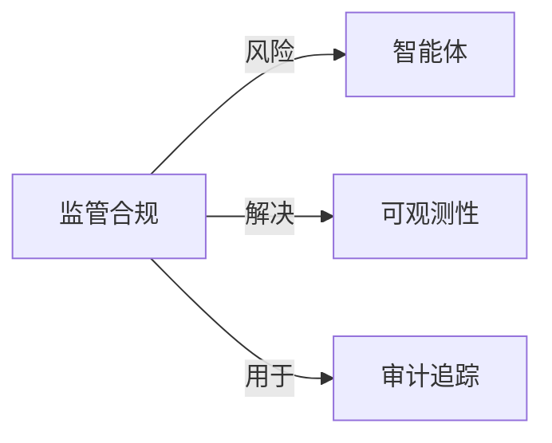

# 监管合规

> **分类**：安全与治理 ｜ **英文**：Regulatory Compliance ｜ **出现于 2 篇文章**

## 摘要

监管合规（Regulatory Compliance）指智能体在设计与运行中需满足多个监管机构的法规与审计要求。它之所以重要，是因为合规要求会从根本上塑造系统架构：若不在第一天就纳入设计，往往要在面临高额罚款后被迫重建。在金融、医疗等受监管行业，合规能力直接决定智能体能否投入生产。

## 关键做法

- 从第一天起把合规纳入智能体架构，而不是事后补充；数据隐私与审计轨迹的基线要求几乎每个国家都有，会直接影响架构选型。
- 建立全面的审计轨迹，追踪智能体的每一项决策及其所使用的数据源，以支持人工审查与监管核查。
- 部署实时监控系统，识别智能体何时进入需要人类判断的边缘情况或不确定场景。
- 设置升级协议，按明确标准自动将复杂案例路由给合适的专家（如临床专家）。
- 性能指标不仅衡量技术准确性，也衡量业务成果与工作流集成成功度，使合规与业务价值可同时被评估。

## 在 Claude 里的用法

在受监管行业落地时，可用 Claude Code 构建面向合规文档的自动化平台：Novo Nordisk 的 NovoScribe 结合 Claude Code 与 MongoDB Atlas，将临床研究报告的产出时间从 10 周以上缩短至 10 分钟，同时保持监管合规标准。围绕这类智能体，应配套审计轨迹、实时监控与升级协议，把合规要求嵌入智能体的运行闭环。

## 常见误区

- 把合规当作上线前的一次性检查：资料明确指出它必须从第一天就是架构的一部分，否则可能面临重建与罚款。
- 只追求技术准确性指标：合规场景下还需衡量业务成果与工作流集成成效，否则无法判断智能体是否真正可用。

## 相关概念

- [智能体](智能体.md) —— 监管合规是智能体在受监管行业落地时的主要风险来源，需在架构层面预先应对。
- [可观测性](可观测性.md) —— 实时监控与性能指标依赖可观测性能力，用以发现需要人类判断的边缘情况。
- [审计追踪](审计追踪.md) —— 全面的审计轨迹是满足监管审查与合规要求的核心手段。

## 知识图谱（Knowledge Graph）

## 来源（Sources）

| # | 文章 | 原文 |
| --- | --- | --- |
| 1 | [为金融服务构建 AI 智能体](../docs/zh/articles/building-ai-agents-in-financial-services.md) | [原文](https://claude.com/resources/articles/building-ai-agents-in-financial-services) |
| 2 | [为医疗健康与生命科学构建 AI 智能体](../docs/zh/articles/building-ai-agents-in-healthcare-and-life-sciences.md) | [原文](https://claude.com/resources/articles/building-ai-agents-in-healthcare-and-life-sciences) |
