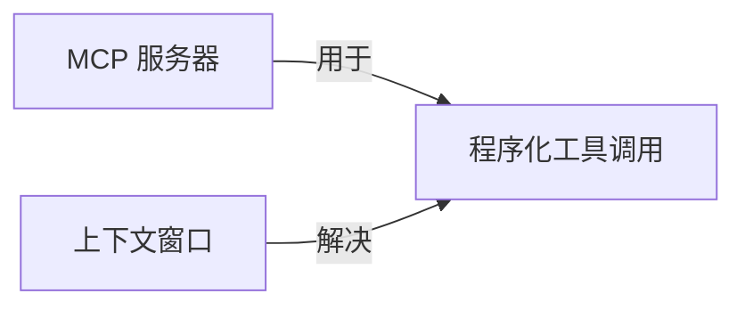

# 程序化工具调用

> **分类**：工具与扩展 ｜ **英文**：Programmatic Tool Calling ｜ **出现于 3 篇文章**

## 摘要

程序化工具调用（Programmatic Tool Calling）是一种让 Claude 在代码执行沙箱中编排工具调用的方式：工具结果先在代码里被处理，只有最终输出返回模型上下文。它之所以重要，是因为它把循环、过滤和聚合放到代码里完成，从而显著降低多步工作流的 token 消耗。

## 关键做法

- 把工具调用写进代码执行沙箱，而不是让模型逐次发起调用并接收原始结果。
- 在代码中完成跨调用的循环、过滤与聚合，只把最终结果送回模型上下文。
- 面向复杂的多步工作流使用这一模式，让中间数据留在沙箱内，避免污染上下文。
- 与 MCP 服务器配合，用代码高效编排 MCP 工具，而不是把每个工具的返回都塞进对话。
- 把它看作建立在通用工具（如 bash 和文本编辑器）之上的组合模式，而非独立的新工具。

## 在 Claude 里的用法

在 Claude 平台上，程序化工具调用作为工具使用能力提供，可在代码执行沙箱中处理工具结果，并用于编排 MCP 服务器暴露的工具。它常与 Agent Skills、记忆工具等一起，作为基于 bash 和文本编辑器等通用工具构建的上层模式使用。在复杂的多步工作流中采用它，可减少进入上下文窗口的内容量。

## 常见误区

- 误以为它只是另一种调用工具的方式：它的关键区别在于工具结果不原样返回模型，而是在沙箱内被处理。
- 误以为所有场景都该用它：资料强调的是它在复杂多步工作流上的收益，简单单次调用未必需要。
- 误以为它与 MCP 互斥：实际上它正是用来编排 MCP 工具的手段之一。

## 相关概念

- [MCP 服务器](MCP-服务器.md) —— 程序化工具调用用于高效编排 MCP 服务器提供的工具。
- [上下文窗口](上下文窗口.md) —— 程序化工具调用通过只返回最终结果，解决上下文窗口被中间结果占满的问题。

## 知识图谱（Knowledge Graph）

## 来源（Sources）

| # | 文章 | 原文 |
| --- | --- | --- |
| 1 | [用 MCP 构建触达生产系统的智能体](../docs/zh/articles/building-agents-that-reach-production-systems-with-mcp.md) | [原文](https://claude.com/resources/articles/building-agents-that-reach-production-systems-with-mcp) |
| 2 | [通过 Skills 和 MCP 服务器扩展 Claude 的能力](../docs/zh/articles/extending-claude-capabilities-with-skills-mcp-servers.md) | [原文](https://claude.com/resources/articles/extending-claude-capabilities-with-skills-mcp-servers) |
| 3 | [智能体执行框架设计：驾驭 Claude 智能的 3 种模式](../docs/zh/articles/harnessing-claudes-intelligence.md) | [原文](https://claude.com/resources/articles/harnessing-claudes-intelligence) |
