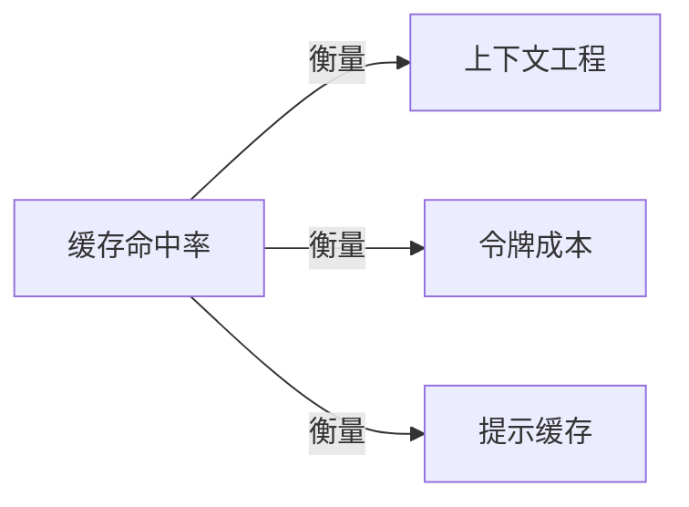

# 缓存命中率

> **分类**：成本与性能 ｜ **英文**：cache hit rate ｜ **出现于 2 篇文章**

## 摘要

缓存命中率指请求中命中提示词缓存部分的比例，直接影响 token 成本与响应延迟。在 Claude Code 中，整个执行框架都围绕提示词缓存构建，高命中率不仅降低成本，也让订阅方案能给出更宽松的速率限制，因此它是需要像监控正常运行时间一样监控的核心指标。

## 关键做法

- 把提示词缓存当作前缀匹配来设计系统：前缀中任何位置的任何改动都会使其后的全部内容失效，顺序排对，大部分缓存就免费生效。
- 用对话中的消息代替系统提示词改动，例如进入计划模式、更改日期等操作，插入消息比编辑系统提示词更好。
- 不要在对话中途更改工具或模型；用工具来建模状态转换，延迟加载工具而不是移除工具。
- 像监控正常运行时间一样监控缓存命中率，对缓存中断设置告警并视为事故，因为几个百分点的未命中率就能显著影响成本和延迟。
- 分叉操作（上下文压缩、总结、Skills 执行等旁路计算）要共享父级前缀，使用相同的缓存安全参数。

## 在 Claude 里的用法

在 Claude Code 中，提示词缓存命中率是执行框架设计的中心约束，团队对其设置告警，过低时宣布 SEV。构建旁路计算（如上下文压缩、总结、Skills 执行）时需复用父级前缀的缓存安全参数，以维持命中率。需要注意的是，模型输出速度的提升（如 Opus 5.5 比 Opus 5 快 30% 以上）并不会提高缓存命中率或减少 token 用量。

## 常见误区

- 认为提升生成速度就能改善缓存命中率：输出速度提升不改变缓存命中率，也不减少 token 用量，只是减少长时间运行中的等待。
- 在对话中途编辑系统提示词或更换工具集：这会破坏前缀匹配，使后续缓存全部失效。
- 把缓存未命中当作小事：几个百分点的未命中率就足以显著推高成本与延迟，应作为事故处理。

## 相关概念

- [上下文工程](上下文工程.md) —— 缓存命中率是衡量上下文组织方式是否合理的一项指标。
- [令牌成本](令牌成本.md) —— 缓存命中率直接决定 token 成本的高低。
- [提示缓存](提示缓存.md) —— 缓存命中率衡量的正是提示缓存的生效程度。

## 知识图谱（Knowledge Graph）

## 来源（Sources）

| # | 文章 | 原文 |
| --- | --- | --- |
| 1 | [编码会话变得更长、使用更多上下文。Claude Opus 5.5 正是为此而生。](../docs/zh/articles/claude-opus-5-5-built-for-coding-sessions-that-use-more-context.md) | [原文](https://claude.com/resources/articles/claude-opus-5-5-built-for-coding-sessions-that-use-more-context) |
| 2 | [构建 Claude Code 的经验：提示词缓存就是一切](../docs/zh/articles/lessons-from-building-claude-code-prompt-caching-is-everything.md) | [原文](https://claude.dev/blog/lessons-from-building-claude-code-prompt-caching-is-everything/) |
