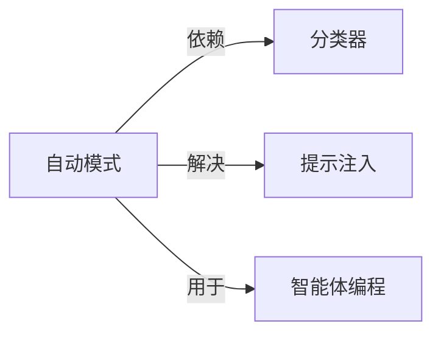

# 自动模式

> **分类**：安全与治理 ｜ **英文**：Auto Mode ｜ **出现于 4 篇文章**

## 摘要

自动模式（Auto Mode）是 Claude Code 中的一种权限模式，它把高风险操作的审批委托给基于模型的分类器，在人工逐条审查与完全跳过权限检查之间取中间路线。它的重要性在于同时缓解智能体编程中"速度与安全"的权衡：既减少权限提示带来的中断，又能拦截提示注入、范围漂移等导致的危险操作。

## 关键做法

- 用分类器审查风险较高的操作，只阻止被判定为危险的操作，其余操作无需审批提示即可运行，让 Claude 自行寻找更安全的替代做法。
- 保留内置安全工具允许列表（文件读取、文本与文件模式搜索、代码导航、todo 与计划模式切换等不改变状态的工具），并为特定工具模式配置始终允许规则。
- 进入自动模式时主动丢弃会授予任意代码执行权限的宽泛规则，例如全量 shell 访问、通配的脚本解释器（python、node、ruby 等）和包管理器运行命令；窄规则（如"允许运行代码格式化工具"）则保留。
- 通过分类器提示词中的三个可自定义槽位定义自己的策略：环境中什么算可信、要阻止哪些类别、要划出哪些例外；固定模板部分无需改动，默认值开箱即用。
- 在前置上下文完整、长时程且你信任模型能安全执行的任务中使用自动模式，以缩短周期时间；对最重要的决策仍保留用户审查。

## 在 Claude 里的用法

在 Claude Code 中，自动模式面向 Max 用户提供研究预览，可用 Shift+Tab 开启，具体用法见权限模式文档。它适用于你已提供完整上下文的长时程任务，能显著减少会话暂停频率。在构建常驻智能体（always-on agents）时，自动模式也被视为让智能体在无持续用户输入下工作的一个方案，但关键决策仍需人工把关。

## 常见误区

- 认为自动模式等于完全跳过权限检查：它仍由分类器审查并阻止危险操作，只是把审批从人工点击改为模型判断。
- 保留为手动审批方便而设置的全量权限规则：这些规则会让分类器看不到最可能造成破坏的命令，进入自动模式时会被丢弃。
- 认为允许列表足够完备：任何列表都不可避免地不完整，分类器与策略槽位仍需按实际使用迭代配置。

## 相关概念

- [分类器](分类器.md) —— 自动模式依赖分类器审查高风险操作并判定是否拦截。
- [提示注入](提示注入.md) —— 自动模式要解决的风险之一，正是提示注入等绕过人工监督的危险来源。
- [智能体编程](智能体编程.md) —— 自动模式用于智能体编程场景，缓解长会话与并行任务中的监督瓶颈。

## 知识图谱（Knowledge Graph）

## 来源（Sources）

| # | 文章 | 原文 |
| --- | --- | --- |
| 1 | [在生产环境中运行自动模式](../docs/zh/articles/auto-mode-in-production.md) | [原文](https://claude.com/resources/articles/auto-mode-in-production) |
| 2 | [在 Claude Code 中使用 Claude Opus 4.7 的最佳实践](../docs/zh/articles/best-practices-for-using-claude-opus-4-7-with-claude-code.md) | [原文](https://claude.com/resources/articles/best-practices-for-using-claude-opus-4-7-with-claude-code) |
| 3 | [构建常驻智能体](../docs/zh/articles/building-always-on-agents.md) | [原文](https://claude.com/resources/articles/building-always-on-agents) |
| 4 | [我们如何构建 Claude Code 自动模式：一种更安全的跳过权限方式](../docs/zh/articles/claude-code-auto-mode.md) | [原文](https://www.anthropic.com/engineering/claude-code-auto-mode) |
