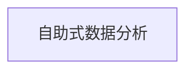

# 自助式数据分析

> **分类**：行业与场景 ｜ **英文**：self-service data analytics ｜ **出现于 2 篇文章**

## 摘要

自助式数据分析指非技术用户无需数据团队介入，就能自行获取数据洞察的工作方式。它之所以重要，是因为临时数据请求会大量消耗数据科学团队的精力；而如果只是简单放宽数据模型，又容易造成定义不一致和指标膨胀。Anthropic 的做法是用 Claude 承接这类查询，让数据团队转向更具战略性的工作。

## 关键做法

- 不要只靠宽表和反规范化表来降低门槛：这样虽然短期易用，但随着业务扩张会出现定义不一致和相互重叠的视图，也无法真正帮助不愿学 SQL 的员工。
- 谨慎对待“圈定边界的环境”：为特定用户群单独搭建受限环境，往往会遗漏长尾业务问题，并因团队各自为政而导致指标和仪表盘膨胀。
- 避免让利益相关方与底层基础设施、文档和专业知识脱节：否则最初摆脱临时请求的轻松，会变成对数据质量与口径的担忧。
- 让自助查询建立在与分析师相同的受治理定义之上，保证非技术用户得到的答案与专业分析口径一致。
- 把重复性的临时查询交给 Claude 自动化，将数据科学团队的精力释放到因果建模、预测和机器学习等战略性工作上。

## 在 Claude 里的用法

在 Anthropic 内部，业务分析查询主要通过 Claude 实现自动化，数据科学团队因此可以专注于更具战略性的分析工作。面向公司其他成员，数据团队通过 Claude Tag（公开测试版）在 Slack 中部署数据分析智能体，任何人都能直接提出数据相关问题，并获得由分析师所用同一套受治理定义支撑的答案。这一能力建立在 Claude Code 之上的智能体式数据分析基础之上，后者是数据科学家和数据工程师的主要开发界面。

## 常见误区

- 认为只要提供宽表或反规范化表，就能实现自助式分析：这反而会带来定义不一致和视图重叠，且无法弥合非技术用户的技能差距。
- 认为为每个团队搭建独立的受限环境更安全：这会遗漏长尾问题，并造成指标与仪表盘在各团队间膨胀。
- 认为自助化意味着可以脱离治理：答案仍需建立在受治理的定义之上，否则用户会与底层基础设施和专业知识脱节。

## 相关概念

- [Claude Code](Claude-Code.md) —— 数据科学家和数据工程师的主要开发界面，是智能体式数据分析的基础。
- [Claude Tag](Claude-Tag.md) —— 在 Slack 中承载数据分析智能体的产品形态，让任何人可直接提问。
- 智能体式准确性 —— 支撑自助式分析答案可靠性的最佳实践方向。

## 知识图谱（Knowledge Graph）

## 来源（Sources）

| # | 文章 | 原文 |
| --- | --- | --- |
| 1 | [Anthropic 如何借助 Claude 实现自助式数据分析](../docs/zh/articles/how-anthropic-enables-self-service-data-analytics-with-claude.md) | [原文](https://claude.com/resources/articles/how-anthropic-enables-self-service-data-analytics-with-claude) |
| 2 | [Slack 中的自助式数据分析：Anthropic 如何部署 Claude Tag 应对临时性问题](../docs/zh/articles/self-service-data-analytics-in-slack-how-anthropic-deploys-claude-tag-for-ad-hoc-questions.md) | [原文](https://claude.com/resources/articles/self-service-data-analytics-in-slack-how-anthropic-deploys-claude-tag-for-ad-hoc-questions) |
