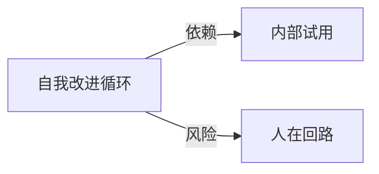

# 自我改进循环

> **分类**：智能体架构 ｜ **英文**：self-improvement loop ｜ **出现于 2 篇文章**

## 摘要
自我改进循环是一种智能体架构机制：把人类或系统的反馈转化为对指令（而非单个示例）的修正，并让修正后的指令回到后续运行中持续迭代。它之所以重要，是因为它让智能体随使用不断变好，而不必每次都在原始提示词里逐例打补丁。

## 关键做法
- 修正原则，而不是修正示例：把专家反馈沉淀为通用规则，避免逐例修复导致指令膨胀。
- 把可复用的知识从原始提示词中抽离出来，以文件形式（如 Skills）编码，便于独立演进。
- 用两个 Skills 夹住人类反馈构建闭环：一个负责执行，一个承载经反馈修正后的指令。
- 让领域专家定期审查和引导模型的推理过程，并确保这些引导被纳入循环。
- 保持人类在关键节点上介入，由人判断哪些反馈应上升为原则。

## 在 Claude 里的用法
在 Claude 平台上，自我改进循环通常用 Skills 实现：Skills 是以文件形式编码的知识，使指令不必直接写进原始提示词，从而可以单独更新。Warp 即在 Claude 上以两个 Skills 加中间的人类反馈搭建了这类自我改进的智能体架构。团队也可让领域专家定期审查 Claude 的推理，并把结论写回 Skills 形成持续迭代。

## 常见误区
- 把自我改进理解为逐例修补输出，而不是更新底层原则，结果指令越改越碎。
- 认为循环可以完全去掉人：资料中的做法仍以人类反馈作为两个 Skills 之间的关键环节。

## 相关概念
- [内部试用](内部试用.md) —— 内部试用中的专家审查与引导是自我改进循环的输入来源，循环依赖这一实践。
- [人在回路](人在回路.md) —— 人类反馈被置于循环中间，是控制自我改进风险的关键设计。

## 知识图谱（Knowledge Graph）

## 来源（Sources）

| # | 文章 | 原文 |
| --- | --- | --- |
| 1 | [面向初创企业的 Claude Code 指南](../docs/zh/articles/claude-code-guide-for-startups.md) | [原文](https://claude.com/resources/articles/claude-code-guide-for-startups) |
| 2 | [Warp 如何在 Claude 上构建自我改进的智能体](../docs/zh/articles/how-warp-builds-self-improving-agents-on-claude.md) | [原文](https://claude.com/resources/articles/how-warp-builds-self-improving-agents-on-claude) |
