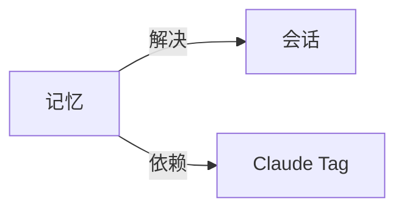

# 记忆

> **分类**：智能体架构 ｜ **英文**：Memory ｜ **出现于 4 篇文章**

## 摘要
记忆（Memory）是智能体架构中用于跨运行持久保存用户指令、笔记与任务进度的存储层。它让常驻智能体在单次运行结束后仍能保留上下文与学习成果，从而避免每次运行都从零开始，是构建 always-on 智能体的关键组件。

## 关键做法
- 为记忆分配独立的存储，并映射到持久化后端（通常是数据库或对象存储），使记忆的生命周期长于工作进程。
- 遵循“只保存无法再次查询到的内容”的原则：若信息已存在于其他系统（如问题跟踪器），只保存指向它的指针。
- 将记忆以文件目录形式组织，让智能体用普通文件工具读写；在 Managed Agents 中该目录会挂载到每次运行沙箱的 `/mnt/memory/` 下并在运行之间保留。
- 用记忆存储保存运行状态（如书签），使下一次运行能覆盖自上次运行以来的全部内容。
- 引入 dreaming：回顾过往会话以整理记忆，替换过时条目，并发现只有在多次运行中才显现的模式。

## 在 Claude 里的用法
在 Claude Code 中可使用自动记忆，在 Messages API 中可使用记忆工具，两者都以文件目录形式实现。在 Claude Managed Agents 上，共享文件夹即记忆存储，多个智能体可读写同一存储，从而复用彼此的学习成果；例如有团队让每个智能体把草稿与用户实际发送的邮件对比，将差异保存为关于措辞偏好的笔记。构建自动化时，记忆与来源、目标、智能体、计划、护栏并列，作为保存用户偏好和智能体自身记忆的配置项。

## 常见误区
- 把一切信息都塞进记忆：已存在于其他系统的内容应只存指针，否则会造成重复与过时。
- 把记忆当作进程内状态：若不落到持久化存储，记忆就无法跨越运行轮次，常驻智能体也就失去连续性。

## 相关概念
- [会话](会话.md) —— 记忆通过回顾过往会话（dreaming）来整理和更新自身，从而解决单次会话上下文无法延续的问题。
- [Claude Tag](Claude-Tag.md) —— Claude Tag 的使用场景依赖记忆来保留用户偏好与历史上下文。

## 知识图谱（Knowledge Graph）

## 来源（Sources）

| # | 文章 | 原文 |
| --- | --- | --- |
| 1 | [构建常驻智能体](../docs/zh/articles/building-always-on-agents.md) | [原文](https://claude.com/resources/articles/building-always-on-agents) |
| 2 | [构建高效的智能体自动化](../docs/zh/articles/building-effective-agent-automations.md) | [原文](https://claude.dev/blog/building-effective-agent-automations/) |
| 3 | [Anthropic 日本的一位 BDR 如何用 Claude Managed Agents 度过一天](../docs/zh/articles/how-an-anthropic-japan-business-development-representative-runs-his-day.md) | [原文](https://claude.com/resources/articles/how-an-anthropic-japan-business-development-representative-runs-his-day) |
| 4 | [Anthropic 员工如何使用 Claude Tag](../docs/zh/articles/how-anthropic-employees-use-claude-tag.md) | [原文](https://claude.com/resources/articles/how-anthropic-employees-use-claude-tag) |
