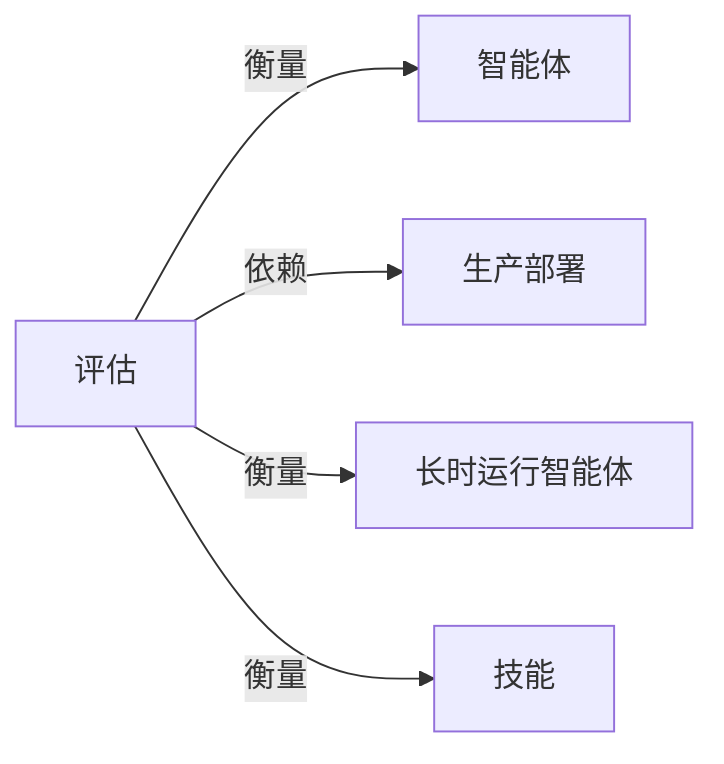

# 评估

> **分类**：评估与验证 ｜ **英文**：evaluation ｜ **出现于 6 篇文章**

## 摘要

评估（evaluation，常简称 eval）是系统化测试 AI 输出质量与可靠性的方法：把“好是什么样子”固化成可重复、可评分的检查，从而让团队能安全地迭代模型、提示词与智能体。它之所以重要，是因为它把主观的“感觉不错”变成可自动化的判断，让模型升级、记忆系统重构这类大规模变更可以自信地推进。

## 关键做法

- 从项目最开始就构建某种版本的评估，不必等到它“完美”或足够正式；越早开始，越能更快把智能体构建出来。
- 把评估理解为对反思过程的结构化、可评分、可自动化版本：先明确“好”的标准，再让一个智能体充当裁判，阅读完整运行记录并打分。
- 让评估任务贴近真实使用方式，包括混乱、描述不充分的提问，例如只粘贴一段堆栈跟踪加一个“fix”，看模型能否自行推断意图、定位根因并验证改动。
- 用评估覆盖多个维度与多个场景，例如同时运行多个场景的评估套件，或衡量延迟、成本与构建错误。
- 主动寻找评估盲点：提示词改动可能破坏缓存、进而在大规模下推高成本这类风险，应纳入检查范围。
- 把评估方法与业务规则一起沉淀为可复用的记忆产物，并通过 Skills（技能）在团队内共享，让其他人基于经过验证的实践构建。

## 在 Claude 里的用法

在 Claude Agent SDK 之上构建智能体构建器时，可以把评估作为从蓝图到实现、再到优化的固定环节，并与对话智能和运行时打通。团队用 Claude Code 做开发时，可让新模型跑一遍覆盖不同应用类型的评估，再借助 A/B 测试基础设施衡量并上线改动。在组织层面，可以设置专门负责 Claude 所遵循的 Skills 以及检验其工作的评估的岗位，把评估职责制度化。

## 常见误区

- 认为必须先设计出“完美案例”才能开始建评估，因而迟迟不动手；实际上早期、不完美的评估也能显著加速智能体开发。
- 只评估顺利路径，忽略缓存命中这类隐性成本与回归风险，导致改动在规模化后暴露问题。

## 相关概念

- [智能体](智能体.md) —— 评估是衡量智能体表现的手段，二者在资料中共同出现。
- [生产部署](生产部署.md) —— 生产部署依赖评估，用以安全地大规模上线与变更。
- [长时运行智能体](长时运行智能体.md) —— 评估用于衡量长时运行智能体的工作质量。
- [技能](技能.md) —— 评估方法可沉淀为 Skills（技能）在团队间共享，评估也用于衡量技能的效果。

## 知识图谱（Knowledge Graph）

## 来源（Sources）

| # | 文章 | 原文 |
| --- | --- | --- |
| 1 | [Cresta 如何将 CX 专业知识转化为基于 Claude Agent SDK 的智能体构建器](../docs/zh/articles/how-cresta-turned-cx-expertise-into-an-agent-builder-on-the-claude-agent-sdk.md) | [原文](https://claude.com/resources/articles/how-cresta-turned-cx-expertise-into-an-agent-builder-on-the-claude-agent-sdk) |
| 2 | [Outtake 如何在 Claude 上构建网络调查员](../docs/zh/articles/how-outtake-built-a-cyber-investigator-on-claude.md) | [原文](https://claude.com/resources/articles/how-outtake-built-a-cyber-investigator-on-claude) |
| 3 | [在前沿工作：Cursor 如何判断 Claude Fable 5 已准备好应对最难的 1% 问题](../docs/zh/articles/working-at-the-frontier-cursor.md) | [原文](https://claude.com/resources/articles/working-at-the-frontier-cursor) |
| 4 | [在前沿工作：Base44 为何将最具挑战性的工程工作托付给 Claude Fable 5](../docs/zh/articles/working-at-the-frontier-why-base44-trusts-claude-fable-5-with-their-most-challenging-engineering-work.md) | [原文](https://claude.com/resources/articles/working-at-the-frontier-why-base44-trusts-claude-fable-5-with-their-most-challenging-engineering-work) |
| 5 | [AI 投资公司](../docs/zh/guides/the-ai-investment-firm.md) | [原文](https://claude.com/resources/guides/the-ai-investment-firm) |
| 6 | [在欧洲使用 Claude 构建：智能体基础](../docs/zh/webinars/building-with-claude-in-europe-agent-fundamentals.md) | [原文](https://claude.com/resources/webinars/building-with-claude-in-europe-agent-fundamentals) |
