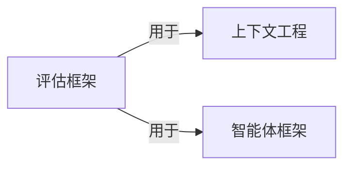

# 评估框架

> **分类**：评估与验证 ｜ **英文**：Evaluation Framework ｜ **出现于 5 篇文章**

## 摘要

评估框架（Evaluation Framework，也称 eval harness、评估套件）是系统化衡量模型或智能体表现、并在结果不理想时定位问题来源的评测基础设施。它的价值不在于给出一个总体分数，而在于把表现拆解到足够细的粒度，让团队能追溯到具体的提示词、上下文或检索缺口。对智能体类产品而言，评估框架既是回归防线，也是持续改进的信号来源。

## 关键做法

- 尽早构建评估框架，并让它足够细粒度、设计成能隔离变量；跳过这一步，后续花在调试上的时间会比构建还多。
- 不要只依赖总体分数：当某个环节表现不佳时，应能追溯到具体的提示词、上下文问题或检索缺口。
- 快速选定一个适合自身工作流的框架即可，把主要精力投入到迭代高质量测试用例和评分器上——框架的价值取决于你通过它运行的评估任务。
- 警惕评估饱和：当智能体通过所有可解任务后，分数不再提供改进信号，大的能力提升可能只表现为分数的小幅增长。
- 当现有评估无法反映真实收益时（例如一次性编码评估捕捉不到长任务上的改进），应针对真实任务形态重新设计智能体式评估框架。

## 在 Claude 里的用法

在 Claude 上构建智能体时，评估套件通常与 Claude 所处的智能体循环、一组 Skills 和工具并列，作为生产架构的固定组成部分；面向消费者的 commerce agents 就采用了这一结构。在 Claude Code 等开发界面中积累的智能体式准确性最佳实践，也可以延伸到 Claude Tag 等部署形态。工程团队可参考 Anthropic 关于智能体评估的公开方法（如 evals 拆解文章）来设计测试用例与评分器。

## 常见误区

- 以为 100% 通过率就是好结果：全部追踪回归而不提供改进信号，往往意味着评估已接近饱和。
- 把框架本身当成目标：框架只是加速与标准化的手段，评估任务和评分器的质量才决定其价值。
- 用一次性、短链路的评估判断模型能力，可能低估模型在更长、更复杂任务上的收益。

## 相关概念

- [上下文工程](上下文工程.md) —— 评估框架用于定位上下文问题，是检验上下文工程质量的手段。
- [智能体框架](智能体框架.md) —— 评估框架用于衡量智能体框架的实际表现并隔离变量。

## 知识图谱（Knowledge Graph）

## 来源（Sources）

| # | 文章 | 原文 |
| --- | --- | --- |
| 1 | [Carta Healthcare 如何让 AI 像临床数据提取员一样推理](../docs/zh/articles/carta-healthcare-clinical-abstractor.md) | [原文](https://claude.com/resources/articles/carta-healthcare-clinical-abstractor) |
| 2 | [揭开 AI 智能体评估的面纱](../docs/zh/articles/demystifying-evals-for-ai-agents.md) | [原文](https://www.anthropic.com/engineering/demystifying-evals-for-ai-agents) |
| 3 | [CodeRabbit 如何用 Claude 构建智能体编排系统](../docs/zh/articles/how-coderabbit-used-claude-to-build-an-agent-orchestration-system.md) | [原文](https://claude.com/resources/articles/how-coderabbit-used-claude-to-build-an-agent-orchestration-system) |
| 4 | [Slack 中的自助式数据分析：Anthropic 如何部署 Claude Tag 应对临时性问题](../docs/zh/articles/self-service-data-analytics-in-slack-how-anthropic-deploys-claude-tag-for-ad-hoc-questions.md) | [原文](https://claude.com/resources/articles/self-service-data-analytics-in-slack-how-anthropic-deploys-claude-tag-for-ad-hoc-questions) |
| 5 | [有效电商智能体的解剖学指南](../docs/zh/articles/the-anatomy-of-effective-commerce-agents.md) | [原文](https://claude.com/resources/articles/the-anatomy-of-effective-commerce-agents) |
