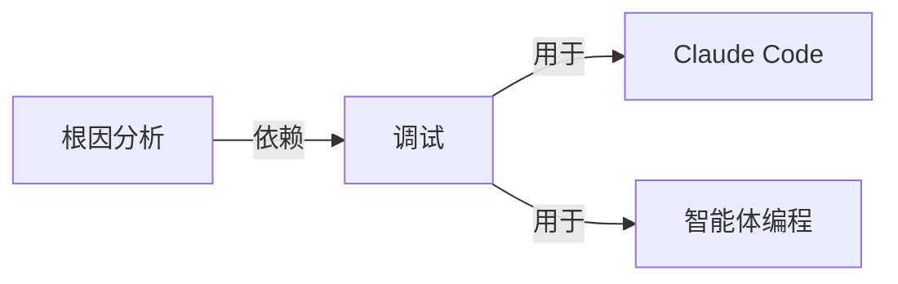

# 调试

> **分类**：Claude Code 与编程 ｜ **英文**：debugging ｜ **出现于 2 篇文章**

## 摘要

调试（Debugging）是定位并修复软件缺陷与生产问题的过程。传统调试依赖翻日志、本地复现、加日志、手动追溯改动等步骤，每一步都需要对系统的深入上下文与关联分析，容易把二十分钟能修好的问题拖成数小时的调查。借助 Claude，调试可以把初步分析与多步排查工作流交给模型，显著缩短从发现问题到实施修复的路径。

## 关键做法

- 先做轻量初步分析：在深入代码库之前，把堆栈跟踪、错误症状粘贴给 Claude，快速获得错误模式分析与具体调查假设，明确该找什么再投入耗时手段。
- 让 Claude 承担多步调试工作流：读取错误跟踪、跨文件分析代码、运行诊断测试并实施修复，而不是等待你逐步下指令。
- 把调试前移到设计阶段：梳理错误状态、逻辑流与系统状态，在设计阶段就识别边缘情况，减少后续调试时间。
- 用生成的运行手册做上下文：让 Claude 摄取多个文档来源，产出 Markdown 运行手册与故障排查指南，调试真实生产问题时往往比搜索完整知识库更高效。
- 把调试与根因分析结合：不止修复表面症状，而是沿调查假设追溯到缺陷的根本原因。

## 在 Claude 里的用法

在 Claude.ai 网页界面中，可以直接粘贴堆栈跟踪、描述缺陷，快速获得带假设和调查路径的分析，任何浏览器、桌面或移动端均可用。在 Claude Code 中，调试是典型的智能体编程场景：它会自主完成读取错误跟踪、跨文件分析、运行诊断测试并实施修复的多步流程，你可以同时专注于其他任务。Anthropic 内部团队也把调试、浏览代码库、管理工作流作为 Claude Code 的常见用途。

## 常见误区

- 认为调试只能靠人工翻日志和本地复现：这些方法有效但很慢，初步分析可以先交给 Claude 缩小范围。
- 把调试只当成开发阶段的事：设计阶段梳理错误状态与逻辑流，能提前发现边缘情况并节省后续调试时间。
- 只让 Claude 修表面症状：应结合根因分析，沿假设追到真正的缺陷来源。

## 相关概念

- [Claude Code](Claude-Code.md) —— 调试是 Claude Code 自主多步工作流的典型应用场景。
- [智能体编程](智能体编程.md) —— Claude Code 以智能体编程方式完成读取错误跟踪、运行测试与实施修复的调试流程。
- [根因分析](根因分析.md) —— 调试依赖根因分析，从症状追溯到缺陷的根本来源。

## 知识图谱（Knowledge Graph）

## 来源（Sources）

| # | 文章 | 原文 |
| --- | --- | --- |
| 1 | [用 Claude 更快修复软件缺陷](../docs/zh/articles/fix-software-bugs-faster-with-claude.md) | [原文](https://claude.com/resources/articles/fix-software-bugs-faster-with-claude) |
| 2 | [Anthropic 各团队如何使用 Claude Code](../docs/zh/articles/how-anthropic-teams-use-claude-code.md) | [原文](https://claude.com/resources/articles/how-anthropic-teams-use-claude-code) |
