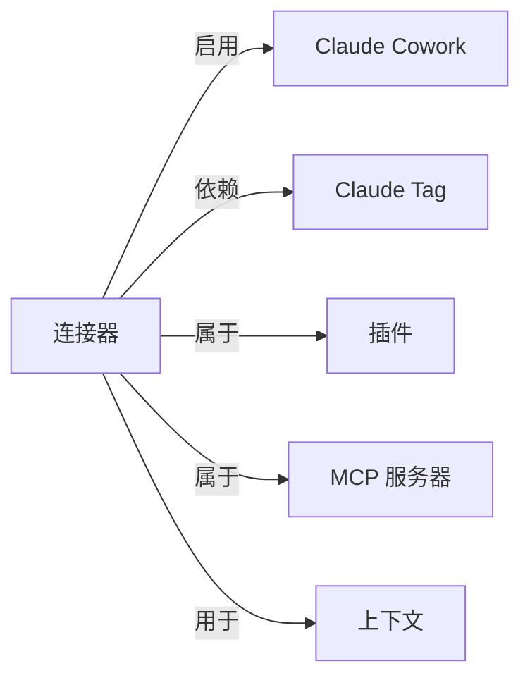

# 连接器

> **分类**：工具与扩展 ｜ **英文**：Connectors ｜ **出现于 7 篇文章**

## 摘要

连接器（Connectors）是把 Claude 接入外部工具与数据源的集成组件，让 Claude 能直接读写邮件、日历、文档、聊天工具、CRM 等系统中的内容，而不必由人手动复制粘贴。它决定了 Claude 在具体工作中能触达多少上下文、能承担多复杂的任务，因此是团队从“个人偶尔用 AI”走向“组织级 AI 工作流”的关键基础设施。

## 关键做法

- 先把日常高频使用的工具接上：电子邮件、日历、文档、团队聊天工具等，每接一项都会拓宽 Claude 无需人工搬运内容就能完成的工作范围。
- 按场景成组配置，而不是零散添加：在 Claude Tag 中把所需连接器、仓库和指令打包成捆绑包，按组织、工作区或频道附加，从而统一设定 Claude 在各处的访问边界。
- 从窄范围起步：初始捆绑包只包含第一个频道工作所必需的内容，再随需求扩展，避免一次性开放过多数据源。
- 区分组织级与个人级连接：管理员捆绑包对频道内所有人一致生效；个人连接器则以提问者本人的权限行事，需由本人批准后才可读取其文档、收件箱或 CRM。
- 对敏感内容采用“允许并审查”，因为答案会发布在频道中，可能被更多人看到。
- 把连接器与 Skills、插件结合：在插件中一次性定义 Claude 该连哪些工具与数据、按什么流程工作，Claude 便会在相关场景自动取用这些上下文。

## 在 Claude 里的用法

在 Claude Cowork 中，先连接你日常使用的工具，Claude 便能判断何时值得调用某个工具，主动去日历或聊天线程中取答案；插件进一步把连接器、工作流与斜杠命令打包，让团队获得一致成果。在 Claude Tag（beta）中，Claude 以智能体身份运行，管理员通过捆绑包为频道统一配置连接器，个人连接器则按提问者权限授权。面向法律等行业，Anthropic 还提供了专为行业工作打造的连接器与执业领域插件。底层上，MCP 为这类连接提供了通用格式。

## 常见误区

- 以为接上连接器就等于配置完成：实际还需明确访问范围（组织级还是个人级）、权限归属与敏感内容的处理方式。
- 把个人连接器当作组织级配置使用：它以提问者权限行事，不同成员的可见数据并不相同，不能假定频道内人人一致。
- 一次性开放过多系统：资料建议从窄范围开始，只接入当前工作真正需要的内容。

## 相关概念

- [Claude Cowork](Claude-Cowork.md) —— 连接器在 Cowork 中被启用，用于把 Claude 接入日常工作工具。
- [Claude Tag](Claude-Tag.md) —— Claude Tag 依赖连接器（及捆绑包）来界定 Claude 在频道中的访问范围。
- [插件](插件.md) —— 连接器属于插件所封装的内容之一，插件把工具连接与工作流一并定义。
- [MCP 服务器](MCP-服务器.md) —— 连接器属于 MCP 生态的一部分，MCP 为 LLM 连接外部系统提供通用格式。
- [上下文](上下文.md) —— 连接器用于为 Claude 提供工作所需的上下文，减少手动搬运信息。

## 知识图谱（Knowledge Graph）

## 来源（Sources）

| # | 文章 | 原文 |
| --- | --- | --- |
| 1 | [构建 AI 原生收入组织](../docs/zh/articles/building-an-ai-native-revenue-organization.md) | [原文](https://claude.com/resources/articles/building-an-ai-native-revenue-organization) |
| 2 | [面向初创企业的 Claude Tag 指南](../docs/zh/articles/claude-tag-guide-for-startups.md) | [原文](https://claude.com/resources/articles/claude-tag-guide-for-startups) |
| 3 | [用插件定制 Cowork](../docs/zh/articles/cowork-plugins.md) | [原文](https://claude.com/resources/articles/cowork-plugins) |
| 4 | [在法律行业部署 Claude](../docs/zh/articles/deploying-claude-across-the-legal-industry.md) | [原文](https://claude.com/resources/articles/deploying-claude-across-the-legal-industry) |
| 5 | [Anthropic 的市场运营团队如何使用 Claude Cowork 自动化报告与营销活动搭建](../docs/zh/articles/how-anthropics-marketing-operations-team-uses-claude-cowork-to-automate-reporting-and-campaign-builds.md) | [原文](https://claude.com/resources/articles/how-anthropics-marketing-operations-team-uses-claude-cowork-to-automate-reporting-and-campaign-builds) |
| 6 | [什么是 Model Context Protocol？将 AI 连接到你的世界](../docs/zh/articles/what-is-model-context-protocol.md) | [原文](https://claude.com/resources/articles/what-is-model-context-protocol) |
| 7 | [在 Claude Cowork 中使用 Claude Fable 5](../docs/zh/articles/working-with-claude-fable-5-in-claude-cowork.md) | [原文](https://claude.com/resources/articles/working-with-claude-fable-5-in-claude-cowork) |
