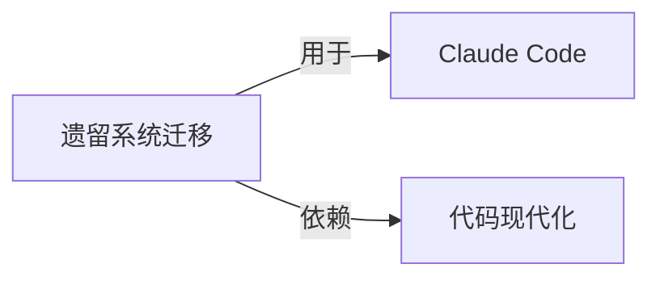

# 遗留系统迁移

> **分类**：行业与场景 ｜ **英文**：legacy system migration ｜ **出现于 2 篇文章**

## 摘要

遗留系统迁移是指把老旧系统及其承载的业务逻辑迁移到新平台的过程。它之所以重要，是因为遗留系统往往沉淀了大量关键业务规则，直接重写风险高，而迁移质量直接决定新系统能否承接原有业务。在 AI 辅助下，这一过程与代码现代化紧密结合，成为金融等行业的典型落地场景。

## 关键做法

- 先梳理遗留系统中隐含的业务逻辑，再规划迁移路径，避免只做语法层面的代码搬运。
- 把迁移视为代码现代化的一部分，借助 AI 理解旧代码结构并生成现代化实现。
- 在真实业务场景（如金融行业的数据分析与系统改造）中分阶段推进，而不是一次性整体替换。
- 用 Claude Code 在代码库层面执行分析与改造任务，把人工判断集中在业务规则确认上。

## 在 Claude 里的用法

在 Claude 产品中，遗留系统迁移主要通过 Claude Code 落地：由 Claude Code 读取和分析既有代码库，辅助完成从旧系统逻辑理解到现代化改造的工作。相关实践在金融行业场景与代码现代化主题的网络研讨会中有所讨论，可与 [代码现代化](代码现代化.md) 的整体方法论配合使用。

## 常见误区

- 把迁移等同于重写代码，忽视对遗留业务逻辑的提取与验证。
- 脱离具体行业场景谈迁移，忽略金融等场景对业务准确性的高要求。

## 相关概念

- [Claude Code](Claude-Code.md) —— 用于执行遗留系统迁移中的代码分析与改造工作。
- [代码现代化](代码现代化.md) —— 遗留系统迁移依赖代码现代化的方法与目标。

## 知识图谱（Knowledge Graph）

## 来源（Sources）

| # | 文章 | 原文 |
| --- | --- | --- |
| 1 | [Claude Code 在金融服务中的应用：从数据分析到遗留系统现代化](../docs/zh/webinars/claude-code-financial-services.md) | [原文](https://claude.com/resources/webinars/claude-code-financial-services) |
| 2 | [将遗留系统转化为战略资产：借助 AI 实现代码现代化](../docs/zh/webinars/deloitte-code-modernization.md) | [原文](https://claude.com/resources/webinars/deloitte-code-modernization) |
