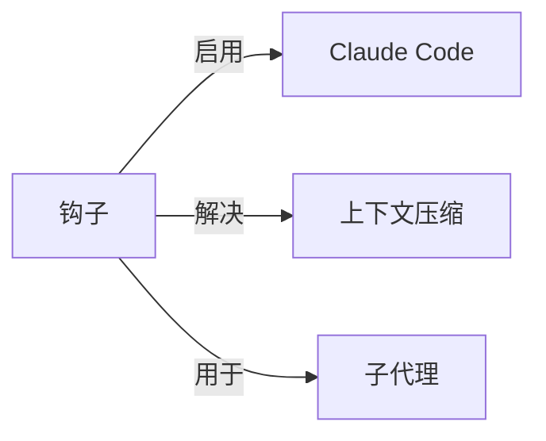

# 钩子

> **分类**：工具与扩展 ｜ **英文**：Hooks ｜ **出现于 7 篇文章**

## 摘要

钩子（Hooks）是用户在 Claude Code 生命周期特定节点配置的自动触发器，以 shell 命令、HTTP 端点或 LLM 提示词的形式，在目标事件发生前或发生后执行自定义逻辑。它把“希望 Claude 遵守的规则”从建议变成确定性执行，因此是构建可靠、可自我改进的智能体工作流的关键机制。

## 关键做法

- 把钩子当作确定性护栏：对 linting、格式化、阻止不安全操作等必须始终成立的规则，用钩子强制执行，结果比依赖 Claude 记住指令更一致。
- 用 stop 钩子做持续改进：在会话结束时反思发生了什么，趁上下文还新鲜提出 CLAUDE.md 更新建议；用 start 钩子动态加载团队或模块特定的上下文。
- 覆盖完整事件面：钩子可在操作执行前拦截、注入智能体上下文、自动化审批，或在操作发生前阻止它，按场景选择合适的触发点。
- 用钩子驱动子智能体：在特定操作上触发钩子，无需手动调用即可运行子智能体任务，实现基于事件的工作流自动化。
- 通过插件分发：把 Skills、钩子和 MCP 配置打包成插件，新成员安装后即获得与团队一致的上下文与能力，并可经托管市场在组织内更新分发。
- 与计划保持同步：当实现偏离计划时，考虑用钩子强制 `plan.md` 与实际变更在同一提交中同步。

## 在 Claude 里的用法

在 Claude Code 中，钩子是五大扩展点之一（与 CLAUDE.md、Skills、插件、MCP 服务器并列），通过配置在会话事件上自动执行。它也是七种指示 Claude 行为的方式之一，专门承担“确定性自动化”的角色。更进阶的用法是 mod：mod 本质上是随插件一起分发的钩子，能实时看到会话中的每个事件，钩子像中间件一样形成链，通过 `next(e)` 把事件交给下一个插件，最终由 Claude Code 执行其原有行为。

## 常见误区

- 只把钩子当成“防止 Claude 做错事”的脚本，忽略了它在持续改进（如反思并建议更新 CLAUDE.md）上的更高价值。
- 以为 Skill 能强制策略落地：Skill 只是建议性的控制，必须始终成立的策略需要在 Skill 背后加上钩子等确定性机制——Skill 使违规变得罕见，钩子使违规几乎不可能。

## 相关概念

- [Claude Code](Claude-Code.md) —— 钩子由 Claude Code 启用，是其核心扩展点之一。
- [上下文压缩](上下文压缩.md) —— 钩子可用于解决上下文相关问题，例如在会话中反思并沉淀上下文更新。
- [子代理](子代理.md) —— 钩子可基于事件自动化子代理工作流，无需手动调用即可触发子代理任务。

## 知识图谱（Knowledge Graph）

## 来源（Sources）

| # | 文章 | 原文 |
| --- | --- | --- |
| 1 | [Claude Code mods 入门](../docs/zh/articles/getting-started-with-claude-code-mods.md) | [原文](https://claude.dev/blog/getting-started-with-claude-code-mods/) |
| 2 | [Claude Code 在大型代码库中如何运作：最佳实践与入门指南](../docs/zh/articles/how-claude-code-works-in-large-codebases-best-practices-and-where-to-start.md) | [原文](https://claude.com/resources/articles/how-claude-code-works-in-large-codebases-best-practices-and-where-to-start) |
| 3 | [Claude Code 高级用户定制：如何配置钩子（hooks）](../docs/zh/articles/how-to-configure-hooks.md) | [原文](https://claude.com/resources/articles/how-to-configure-hooks) |
| 4 | [引导 Claude Code：何时使用 CLAUDE.md、Skills、钩子（hooks）与子智能体](../docs/zh/articles/steering-claude-code-skills-hooks-rules-subagents-and-more.md) | [原文](https://claude.com/resources/articles/steering-claude-code-skills-hooks-rules-subagents-and-more) |
| 5 | [如何在 Claude Code 中使用子智能体，以及何时使用](../docs/zh/articles/subagents-in-claude-code.md) | [原文](https://claude.com/resources/articles/subagents-in-claude-code) |
| 6 | [AI 原生 SDLC 实战手册](../docs/zh/articles/the-ai-native-sdlc-playbook.md) | [原文](https://claude.com/resources/articles/the-ai-native-sdlc-playbook) |
| 7 | [Claude Code 最佳实践：来自 Lightspeed 投资组合公司的高级用户洞见](../docs/zh/webinars/claude-code-best-practices-lightspeed.md) | [原文](https://claude.com/resources/webinars/claude-code-best-practices-lightspeed) |
