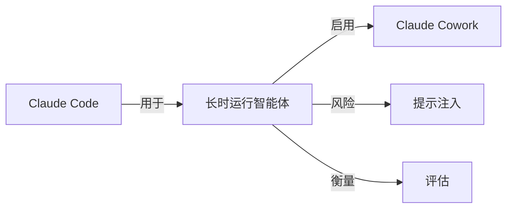

# 长时运行智能体

> **分类**：智能体架构 ｜ **英文**：long-running agent ｜ **出现于 4 篇文章**

## 摘要

长时运行智能体（long-running agent）指能够连续数小时在无人监督的情况下自主执行复杂任务的智能体。它的重要性在于把 AI 的使用从"一问一答"推进到"委托一整段工作"：模型需要自己规划步骤、检查中间结果并把任务推进到可交付的成果，这直接决定了智能体能承担多大范围的真实工作。

## 关键做法

- 把任务描述成目标、期望结果和节奏，而不是逐步指令；由智能体自行列出步骤并推进，人只在关键节点参与。
- 让智能体具备检查自身工作的能力，使其能在无人值守的时段（例如夜间）发现并修正偏差，而不是一次性输出后即结束。
- 为长时任务配置必要的环境访问能力，例如读写本地文件、连接 Slack、Google Drive 等外部应用，使多步骤任务能落到真实交付物上。
- 要求产出附带引用，指向实际的文件和消息，便于人在事后核验长时运行的结果。
- 对长时运行带来的安全暴露面保持警惕：恶意行为者会借助 AI 能力伪装意图、加快攻击执行并获得更深访问权限，因此需要相应的防护与控制手段。

## 在 Claude 里的用法

在 Claude 产品矩阵中，Claude Cowork 是面向跨应用知识工作的长时运行智能体，运行在 Claude 桌面应用中，支持本地文件访问、子智能体和长时间运行的工作，并可承担定时任务；Claude Code 则用于编码场景，Rakuten 的实践显示新一代模型能自主运行更长时间，在夜间完成细致复杂的任务。选择工具时可依据任务性质：对话式起草用 chat，编码用 Claude Code，跨应用知识工作用 Claude Cowork。构建自定义智能体时，也可在 Google Cloud 上基于 Claude 模型完成搭建与治理。

## 常见误区

- 把长时运行等同于"一次很长的对话"：它的关键在于智能体能自主规划、检查并推进到交付物，而非对话轮次多。
- 认为无人监督就意味着人完全退出：实践中仍需人设定目标与节奏，并在过程中保持参与和事后核验。

## 相关概念

- [Claude Code](Claude-Code.md) —— 编码场景中承载长时运行任务的智能体产品。
- [Claude Cowork](Claude-Cowork.md) —— 支持长时间运行工作和定时任务的知识工作智能体。
- [提示注入](提示注入.md) —— 长时运行中需要防范的风险之一。
- [评估](评估.md) —— 用于衡量长时运行智能体在长时间跨度上的表现。

## 知识图谱（Knowledge Graph）

## 来源（Sources）

| # | 文章 | 原文 |
| --- | --- | --- |
| 1 | [Outtake 如何在 Claude 上构建网络调查员](../docs/zh/articles/how-outtake-built-a-cyber-investigator-on-claude.md) | [原文](https://claude.com/resources/articles/how-outtake-built-a-cyber-investigator-on-claude) |
| 2 | [Claude Cowork 产品指南](../docs/zh/articles/the-claude-cowork-product-guide.md) | [原文](https://claude.com/resources/articles/the-claude-cowork-product-guide) |
| 3 | [在前沿工作：Rakuten 如何借助 Claude Fable 5 在一夜之间构建智能体](../docs/zh/articles/working-at-the-frontier-rakuten.md) | [原文](https://claude.com/resources/articles/working-at-the-frontier-rakuten) |
| 4 | [在 Google Cloud 上使用 Claude 模型构建智能体](../docs/zh/webinars/build-agents-with-claude-platform-on-google-cloud.md) | [原文](https://claude.com/resources/webinars/build-agents-with-claude-platform-on-google-cloud) |
