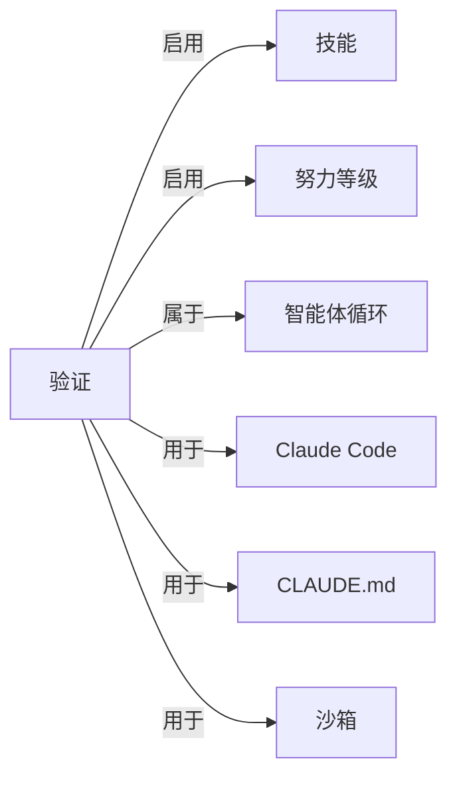

# 验证

> **分类**：评估与验证 ｜ **英文**：Verification ｜ **出现于 8 篇文章**

## 摘要

验证（Verification）是智能体在给出回复之前检查自身工作是否达到完成标准的过程，它构成智能体循环中「采取行动—验证结果—必要时回到收集上下文」的闭环。验证之所以重要，是因为它把「做完了」从主观判断变成可对照基准真相的客观检查：当验证是客观的（测试、类型检查器、linter、运行时错误），模型就能持续打磨而无需人类仲裁质量。

## 关键做法

- 优先利用代码库中的确定性信号做验证，包括类型检查器、linter、测试和运行时错误；Claude 无法自行推断的部分，才需要转成手动检查步骤。
- 把重复出现的手动检查步骤编码为 SKILL.md，形成可复用的验证循环，让 Claude 端到端地检查更多自己的工作，从而减少轮次。
- 为任务设定可验证的退出标准与明确的轮次上限（例如「尝试 5 次后停止」），让循环有客观的停止条件。
- 让失败自己变成待办：当编译器或测试运行失败时，这次失败就成为智能体下一个要修复的条目。
- 在验证与边界情况测试价值高的领域（如硬件、代码审查、安全）投入更高的 effort，让 Claude 在判断和验证上采取更多独立行动。
- 对多智能体产出的发现项做交叉验证：由另一组智能体对每个发现项投票，只有足够多的智能体同意才发布，以过滤误报。

## 在 Claude 里的用法

在 Claude Code 中，验证循环是一个迭代过程，Claude 在其中检查并尝试修复自己的工作；你可以通过 Skills 把验证步骤固化下来。effort 级别直接调节 Claude 做多少验证和边界情况测试：更高的 effort 意味着它会读取更多文件、运行测试、反复核对后才回到你面前。在安全扫描等场景中，验证是发现、验证、分类、修复循环中的独立一步，借助沙箱独立确认哪些发现确实可利用。CLAUDE.md 与技能则用于把项目级的验证规则和检查流程沉淀给智能体遵循。

## 常见误区

- 把验证等同于「多思考一会儿」：effort 控制的是整体工作量（读文件、用工具、执行步骤的数量），而不只是思考时间。
- 在缺乏客观裁判的任务上期待验证效果：当验证是客观的，智能体表现最佳；没有基准真相时，质量仍需人类仲裁。
- 把所有检查都留给人手动做：这些手动步骤本可以转化为验证循环，交给 Claude 自行执行。

## 相关概念

- [技能](技能.md) —— 把验证步骤编码为 SKILL.md，是启用和固化验证循环的主要手段。
- [努力等级](努力等级.md) —— 调节 Claude 投入多少验证与边界情况测试的关键设置。
- [智能体循环](智能体循环.md) —— 验证是「收集上下文—行动—验证」这一循环中的一环。
- [Claude Code](Claude-Code.md) —— 验证循环的主要落地产品，提供测试、lint 等确定性信号。
- [沙箱](沙箱.md) —— 用于隔离智能体并验证漏洞可利用性的环境。

## 知识图谱（Knowledge Graph）

## 来源（Sources）

| # | 文章 | 原文 |
| --- | --- | --- |
| 1 | [Anthropic 如何用 Claude Code 运行大规模代码迁移](../docs/zh/articles/ai-code-migration.md) | [原文](https://claude.com/resources/articles/ai-code-migration) |
| 2 | [在 Claude Code 中用 Skills 构建验证循环](../docs/zh/articles/building-verification-loops-in-claude-code-with-skills.md) | [原文](https://claude.com/resources/articles/building-verification-loops-in-claude-code-with-skills) |
| 3 | [在 Claude Code 中选择 Claude 模型与 effort 级别](../docs/zh/articles/claude-model-and-effort-level-in-claude-code.md) | [原文](https://claude.com/resources/articles/claude-model-and-effort-level-in-claude-code) |
| 4 | [循环工程：循环入门](../docs/zh/articles/getting-started-with-loops.md) | [原文](https://claude.com/resources/articles/getting-started-with-loops) |
| 5 | [Anthropic 如何借助 Claude 实现自助式数据分析](../docs/zh/articles/how-anthropic-enables-self-service-data-analytics-with-claude.md) | [原文](https://claude.com/resources/articles/how-anthropic-enables-self-service-data-analytics-with-claude) |
| 6 | [Claude Code 团队如何进行代码审查](../docs/zh/articles/solving-code-review-at-anthropic.md) | [原文](https://claude.dev/blog/solving-code-review-at-anthropic/) |
| 7 | [使用 Claude Code：花好你的 effort](../docs/zh/articles/spending-your-effort.md) | [原文](https://claude.dev/blog/spending-your-effort/) |
| 8 | [使用 LLM 保护源代码安全](../docs/zh/articles/using-llms-to-secure-source-code.md) | [原文](https://claude.com/resources/articles/using-llms-to-secure-source-code) |

## 反向链接（Backlinks）

- [CLAUDE.md](CLAUDE-md.md)
- [误报](误报.md)
